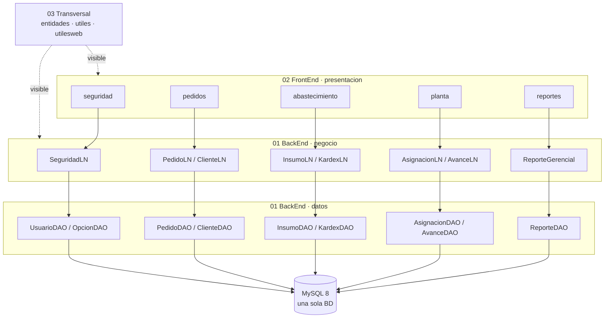
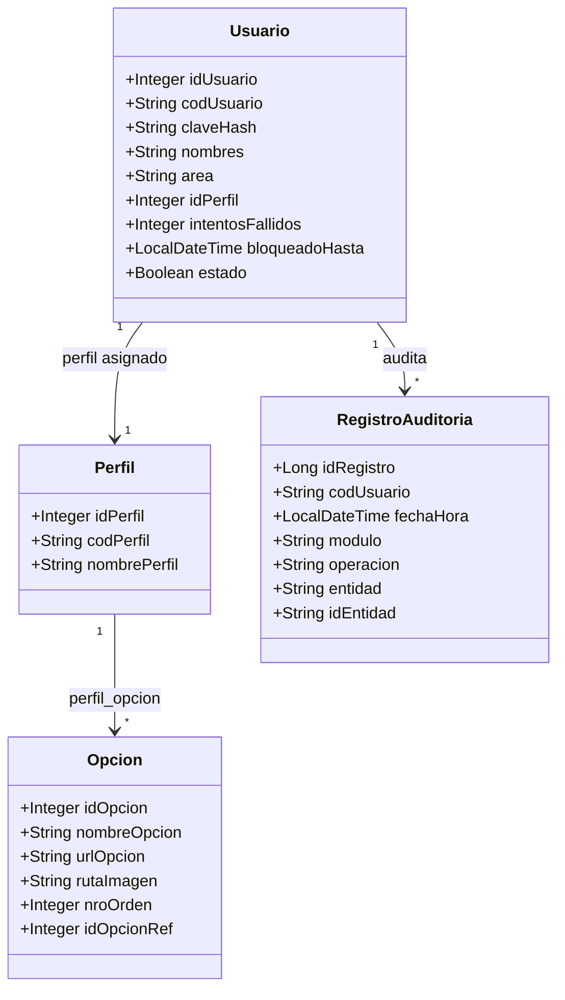
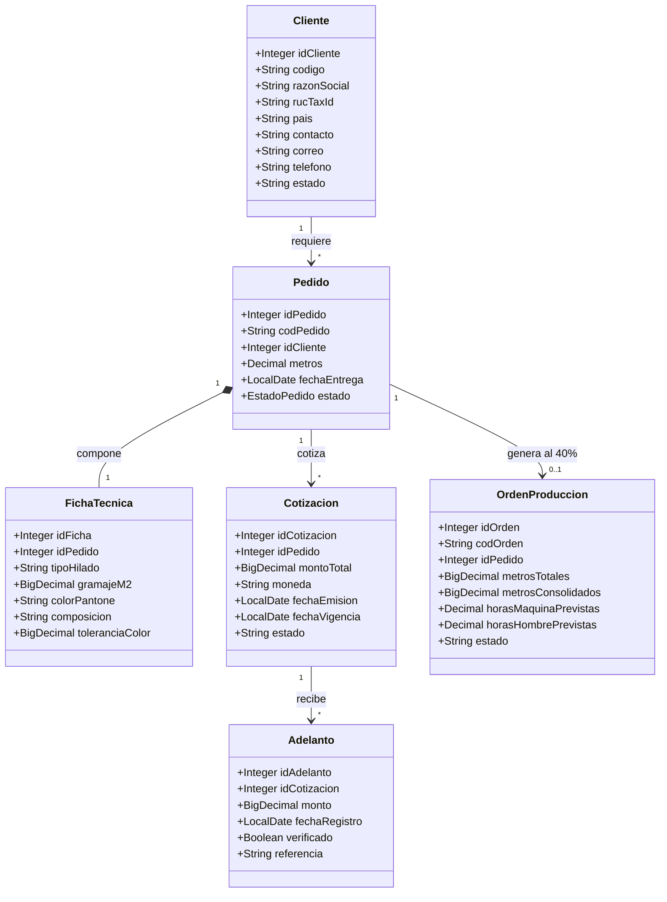
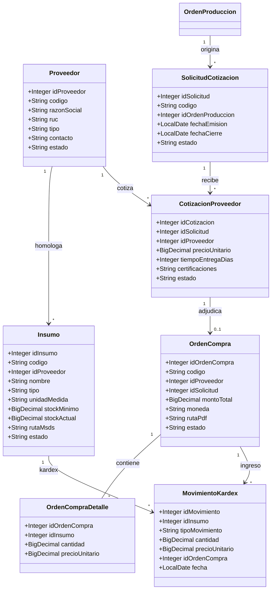
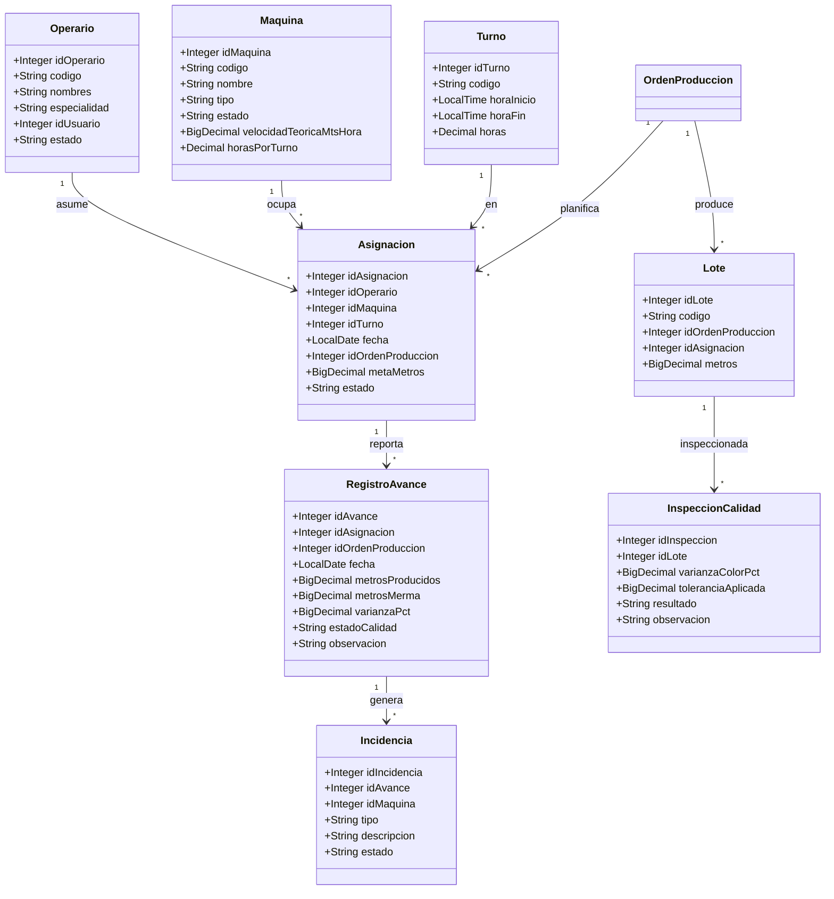
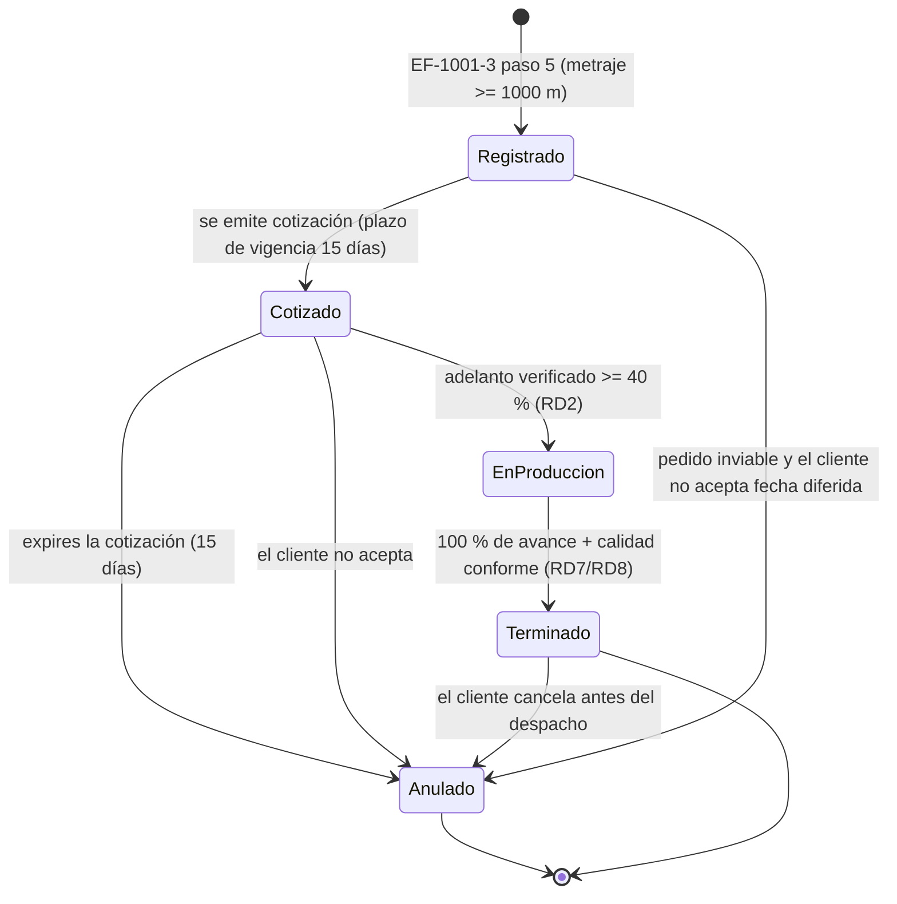
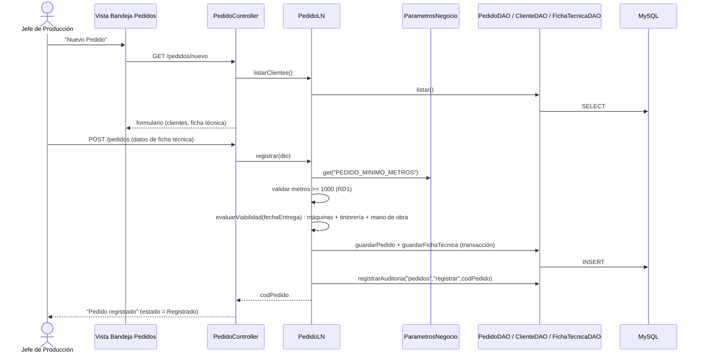
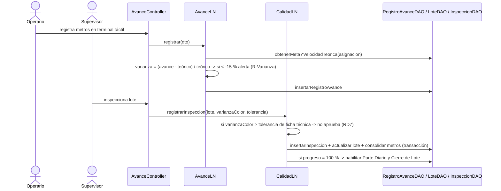
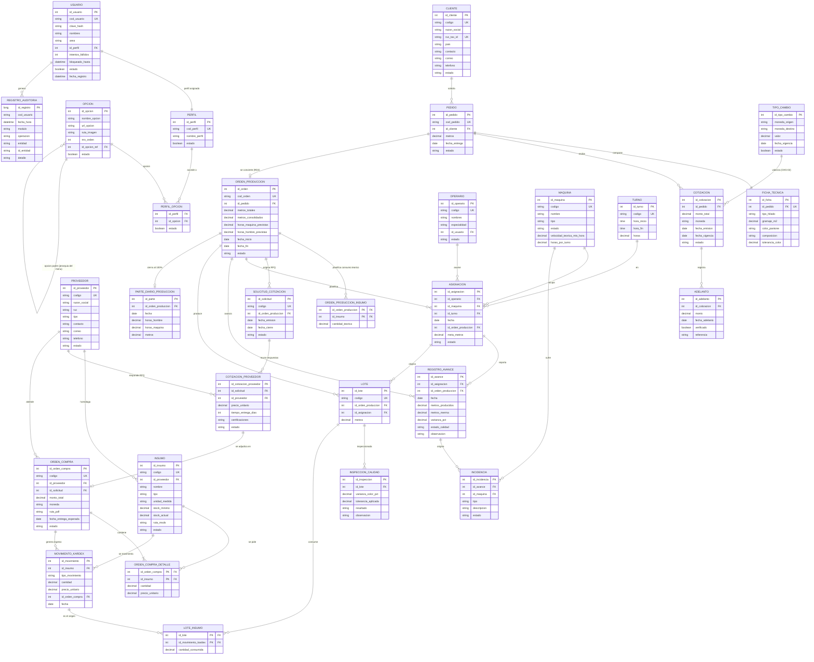

# SIGPT — Documento de Arquitectura de Software

**Sistema:** Sistema Integral de Gestión de Producción Textil (SIGPT)
**Empresa:** Textiles Andinos S.A.C. (UNMSM – FISI)
**Versión:** 1.2 — decisiones D‑P1 a D‑P7 resueltas; stack fijo en Spring Boot 3.5.16 (CHG‑01 anulado); sección 14 con el plan de entregables a 3 semanas (12/11/2026)
**Curso:** Diseño de Software / Ingeniería de Software
**Equipo:** Grupo N.º 4 — Aguirre Ircash L. E. · Arizaga Paez J. R. F. · Ccapcha Espinoza B. R. · Ushiñahua Castañeda P. C. · Ventura Enciso A. J.

---

## 0. Fuentes y trazabilidad documental

| # | Documento | Uso en este documento |
|---|-----------|------------------------|
| F1 | `G4 - Modelo de Negocio - Textiles Andinos S.A.C.pdf` (83 pág.) | Perfil del proyecto (p.5–11), Visión (p.12–28), 3 Casos de Uso del Negocio (p.29–55), Especificación de Requerimientos v1.0 (p.56–83) |
| F2 | `G4 - SIGPT - Especificacion_de_Requerimientos_Semana15.pdf` (40 pág.) | Especificación funcional y no funcional con wireframes de pantalla |
| F3 | `Proyecto para crear Menus y Seguridad capas.pdf` (77 pág.) | Laboratorio del curso (.NET): estructura n-capas, menú dinámico, seguridad |
| F4 | `SIGPT_Decisiones_de_Diseno.md` | Decisiones D1–D10 ya argumentadas; este documento las consolida y las amplía |

**Criterio rector:** cuando F1 y F2 difieren, prima F1 (documento final del curso, más completo). Las diferencias están registradas en §12.

**Abreviaturas:** RD = Requisito de Dominio · RC = Requisito de Calidad · RNF = lista simple de RNF (F2) · EF = Especificación Funcional · CUN = Caso de Uso del Negocio · LN = Lógica de Negocio.

---

## 1. Resumen de decisiones (D1–D10)

| # | Tema | Decisión |
|---|------|----------|
| D1 | Estilo arquitectónico | Monolito modular en capas (3 niveles), cliente-servidor web |
| D2 | Infraestructura | On-premise, dentro de la LAN de la planta; respaldo externo |
| D3 | Lenguaje y plataforma | Java 17 + Spring Boot (solo MVC + inyección) + MySQL 8 + Maven |
| D4 | Organización del código | 3 niveles y capas del laboratorio; dentro de cada capa, un paquete por módulo de negocio |
| D5 | Presentación | MVC con vistas en servidor (Thymeleaf); dos familias de pantallas (oficina y planta táctil) |
| D6 | Lógica de negocio | Clases LN como fachada de cada módulo; ahí viven las reglas RD1–RD8 |
| D7 | Acceso a datos | Clases DAO con JDBC y SQL parametrizado, detrás de interfaces |
| D8 | Seguridad | Login propio por sesión; menú y permisos por perfil leídos de la BD |
| D9 | Patrones | Fachada, Template Method, Estrategia, Factoría, Adapter, Singleton; State y Observer como segunda prioridad |
| D10 | Proceso | Scrum con sprints de 2 semanas; documento de arquitectura con vistas 4+1 |

---

## 2. Vista de escenarios

### 2.1 Alcance funcional

7 casos de uso del sistema (EF‑1001‑2 a EF‑1001‑8) sobre 8 actores:

| Código | Caso de uso | Actor principal | Módulo |
|--------|-------------|------------------|--------|
| EF‑1001‑2 | Iniciar Sesión (Login) | Todos los perfiles | seguridad |
| EF‑1001‑3 | Gestionar Pedido Textil | Jefe de Producción | pedidos |
| EF‑1001‑4 | Gestionar Clientes | Jefe de Producción | pedidos |
| EF‑1001‑5 | Gestionar Proveedores e Insumos | Jefe de Logística / Encargado de Almacén | abastecimiento |
| EF‑1001‑6 | Asignar Operarios y Maquinaria | Supervisor de Tareas | planta |
| EF‑1001‑7 | Registrar Avance de Producción y Control de Calidad | Operario / Supervisor | planta |
| EF‑1001‑8 | Generar Reportes Gerenciales | Jefe de Producción / Gerencia General | reportes |

**Fuera de alcance (F1 p.60):** contabilidad financiera profunda, planillas de personal, integración SUNAT.
**Fuera de alcance (decisión D‑P4, §12.3):** despacho y exportación con guía de remisión y contenedor. El pedido termina en el estado **Terminado**; el CUN lo define, pero ningún caso de uso del sistema lo formaliza, y su construcción arrastraría facturación y logística naviera, que ya están fuera de alcance.

### 2.2 Matriz de accesos por perfil (Anexo 2, F1 p.83 / F2 p.40)

| Funcionalidad | J.Prod | J.Logíst | Superv | Operario | Almacén | Cliente | Proveedor | Gerencia |
|---|---|---|---|---|---|---|---|---|
| Iniciar Sesión | X | X | X | X | X | X | X | X |
| Gestionar Pedido Textil | X | | | | | | | |
| Gestionar Clientes | X | | | | | | | X |
| Gestionar Proveedores e Insumos | | X | | | X | | | |
| Asignar Operarios y Maquinaria | | | X | | | | | |
| Registrar Avance y Calidad | | | X | X | | | | |
| Consultar Estado de Pedido | | | | | | X | X | |
| Generar Reportes Gerenciales | X | | | | | | | X |

> **Decisión D‑P1 (resuelta):** el acceso a reportes queda en **Jefe de Producción y Gerencia General**, que es lo que nombra EF‑1001‑8. El tercer "X" de la Matriz de Accesos del Anexo 2 (F1 p.83 / F2 p.40) se interpreta como un error del documento base y se corrige con **CHG‑04** (§12.1). Semilla correspondiente: `perfil_opcion` sin la opción de reportes para el Supervisor de Tareas.

### 2.3 Reglas de dominio (RD1–RD8) con criterio de aceptación

| Código | Regla | Prioridad | Criterio de aceptación |
|---|---|---|---|
| RD1 | Pedido mínimo de 1 000 m | Alta | El sistema rechaza/advierte pedidos con metraje inferior antes de generar la orden |
| RD2 | La producción solo inicia tras adelanto del 40 % del valor pactado | Alta | No se puede generar la orden de producción sin adelanto registrado y validado |
| RD3 | Ningún operario en turnos consecutivos que superen 16 h continuas | Alta | El sistema impide la asignación y alerta al Supervisor |
| RD4 | El consumo real de insumos no debe exceder en más de 15 % el teórico planificado | Alta | Varianza > 15 % genera alerta automática al Jefe de Producción |
| RD5 | Todo insumo químico/tinte requiere MSDS antes de su uso | Media | No se permite el ingreso al Kardex sin el MSDS asociado |
| RD6 | Trazabilidad del lote desde el ingreso de la materia prima hasta el despacho | Alta | El reporte de lote muestra origen de la materia prima, turnos involucrados y control de calidad |
| RD7 | La aprobación de calidad considera la varianza de color/tinte frente a la ficha técnica | Media | El Supervisor no aprueba lotes cuya varianza de color excede la tolerancia de la ficha técnica |
| RD8 | El producto de exportación debe cumplir la ficha técnica acordada | Alta | El despacho solo se habilita cuando el control de calidad confirma el cumplimiento |

> **Corrección importante:** RD4 y R‑Varianza (EF‑1001‑7) son **dos reglas distintas** con el mismo umbral del 15 %:
> - **R‑Varianza (avance):** metros producidos vs. **velocidad teórica del telar** → alerta "Baja Productividad o Parada no Reportada".
> - **RD4 (consumo):** consumo real de insumos vs. **consumo teórico planificado** → alerta al Jefe de Producción.
> Se implementan como dos métodos separados y dos umbrales en la tabla `parametro`.

### 2.4 Requisitos de calidad: RNF (F2) ↔ RC (F1)

| RNF | RC | Nombre | MoSCoW | Criterio de verificación (F1) |
|---|---|---|---|---|
| RNF01 | RC1 | Rendimiento — respuesta < 2 s en consultas de planta | **Must** | Pruebas de rendimiento con carga simulada de los tres turnos |
| RNF02 | RC2 | Seguridad — perfiles, cifrado, VPN, kiosko | **Must** | Auditoría de seguridad y pruebas de penetración |
| RNF03 | RC3 | Confiabilidad / Disponibilidad (3 turnos) | **Must** | Objetivo 99,5 % en horario de operación, monitoreado con KPIs |
| RNF07 | RC7 | Respaldo y recuperación | **Must** | Prueba periódica de restauración en entorno controlado |
| RNF04 | RC4 | Usabilidad — táctil y responsiva | Should | Pruebas con operarios reales; registro sin asistencia |
| RNF05 | RC5 | Mantenibilidad — modularidad y documentación | Should | Revisión de cobertura documental y de modularidad |
| RNF06 | RC6 | Portabilidad — Win 10/11, Linux, MySQL 8, HTML5 | Should | Verificación en SO y navegadores objetivo |
| RNF08 | RC8 | Auditoría — usuario y fecha/hora en tablas históricas | Should | Cada operación crítica deja traza |

### 2.5 Requisitos de desarrollo (RDS1–RDS6)

| Código | Aspecto | Especificación | Impacto en el diseño |
|---|---|---|---|
| RDS1 | Entorno | Java 17 LTS, Spring Boot 3.x, MySQL 8.0, Maven | Fija D3 (ver CHG‑01 sobre la versión de Spring Boot) |
| RDS2 | Metodología | Scrum, sprints de 2 semanas, daily, retrospectiva | Fija D10 |
| RDS3 | Herramientas | IntelliJ / VS Code, Git + GitHub, **GitHub Actions** | CI/CD obligatorio (ver §9.2) |
| RDS4 | Codificación | Google Java Style, **nombres en español para entidades del dominio**, PR obligatoria | Justifica `PedidoLN`, `InsumoDAO`, etc. |
| RDS5 | Seguridad | **OWASP Top 10**: validación de entradas, manejo seguro de sesiones, cifrado de contraseñas, secretos fuera del código | Ver §7.3 |
| RDS6 | Pruebas | **JUnit 5 + pruebas de integración + pruebas de carga (JMeter)** | Ver §9.3 |

### 2.6 Gestión de cambios (GC‑1005 / EF‑1001‑15)

Proceso de 6 etapas con código `CHG-NNNN`: Identificación → Evaluación (costo, cronograma, recurso, riesgo) → Aprobación por el **CCB** (líder del equipo + Jefe de Producción + representante de Gerencia) → Implementación → Documentación → Verificación. Herramientas: Git/GitHub, PR, tablero (GitHub Projects / Jira / Trello), GitHub Actions.

> **Consecuencia directa:** las desviaciones del diseño base (p. ej. la versión de Spring Boot) **no se anotan al pie**, se registran como solicitudes de cambio. Ver §12.

---

## 3. Vista lógica — niveles, capas y módulos

### 3.1 Estructura de niveles y capas (D4)

```
01 BackEnd
  ├─ negocio     LN          Clases LN: fachada de cada módulo; reglas RD1–RD8
  └─ datos        DAO         Interfaces DAO + implementación JDBC
02 FrontEnd
  └─ presentacion            Controladores MVC + vistas Thymeleaf
03 Transversal
  ├─ entidades              Clases del dominio (nombres en español, RDS4)
  ├─ utiles                 Hash, log, correo, parámetros, exportación
  └─ utilesweb              Filtros de sesión/permisos, armado del menú, binders
```

**Reglas de dependencia (estrictas):**

| Capa | Puede ver | NO puede ver |
|------|-----------|--------------|
| presentacion | negocio, entidades, utiles, utilesweb | **datos** |
| negocio | **interfaces** DAO, entidades, utiles | implementación concreta de DAO |
| datos | entidades, utiles | negocio, presentacion |
| entidades | utiles | cualquier otra capa |
| utiles | — | todo |
| utilesweb | entidades, negocio, utiles | datos |

> La prohibición de `presentacion → datos` es más estricta que el laboratorio (F3 p.5, donde la capa web sí veía AccesoDatos). Se aplica porque ninguna pantalla debe saltarse una regla de negocio; además es lo que exige D6 y RC5 (modularidad).

### 3.2 Módulos de negocio (D4)

| Módulo | Casos de uso | Proceso de negocio |
|--------|--------------|--------------------|
| seguridad | EF‑1001‑2 | Transversal |
| pedidos | EF‑1001‑3, EF‑1001‑4 | Atención al Cliente |
| abastecimiento | EF‑1001‑5 | Gestión de Materias Primas |
| planta | EF‑1001‑6, EF‑1001‑7 | Gestión de Tareas de Operarios |
| reportes | EF‑1001‑8 | Transversal (solo lectura) |

**Regla de comunicación:** un módulo usa a otro **solo a través de la clase LN** del otro (p. ej. `planta` pregunta a `pedidos` por las órdenes "En Producción"). Nunca se tocan tablas ni DAOs ajenos. Esto da independencia funcional (Semana 1) y permite trabajar un módulo en paralelo.

### 3.3 Estructura de paquetes (proyección Java)

```
com.textilesandinos.sigpt
├── presentacion
│   ├── seguridad      LoginController, InicioController, ErrorController
│   ├── pedidos        PedidoController, ClienteController
│   ├── abastecimiento ProveedorController, InsumoController, KardexController
│   ├── planta        AsignacionController, AvanceController, CalidadController
│   ├── reportes      ReporteController
│   └── comun          AtributosGlobales (@ControllerAdvice)
├── negocio
│   ├── seguridad      SeguridadLN, ResultadoAutenticacion
│   ├── pedidos        PedidoLN, ClienteLN
│   ├── abastecimiento ProveedorLN, InsumoLN, KardexLN
│   ├── planta        AsignacionLN, AvanceLN, CalidadLN
│   ├── reportes      ReporteGerencialLN, FabricaReportes, formato/*
│   └── comun          ParametrosNegocio (Singleton con las reglas)
├── datos
│   ├── comun          DaoBase, ExcepcionDatos, Mapeador, ParametroSql,
│   │                  ParametroDAO(+Impl), AuditoriaHelper
│   ├── seguridad      UsuarioDAO, PerfilDAO, OpcionDAO, RegistroAuditoriaDAO (+Impl)
│   ├── pedidos        PedidoDAO, ClienteDAO, FichaTecnicaDAO, CotizacionDAO,
│   │                  AdelantoDAO, OrdenProduccionDAO
│   ├── abastecimiento ProveedorDAO, InsumoDAO, SolicitudCotizacionDAO,
│   │                  CotizacionProveedorDAO, OrdenCompraDAO, KardexDAO
│   ├── planta        OperarioDAO, MaquinaDAO, TurnoDAO, AsignacionDAO,
│   │                  RegistroAvanceDAO, LoteDAO, InspeccionCalidadDAO, IncidenciaDAO
│   └── reportes      ReporteDAO
├── entidades
│   ├── seguridad      Usuario, Perfil, Opcion, RegistroAuditoria
│   ├── pedidos        Cliente, Pedido, FichaTecnica, Cotizacion, Adelanto, OrdenProduccion
│   ├── abastecimiento Proveedor, Insumo, SolicitudCotizacion, CotizacionProveedor,
│   │                  OrdenCompra, OrdenCompraDetalle, MovimientoKardex, OrdenProduccionInsumo
│   ├── planta        Operario, Maquina, Turno, Asignacion, RegistroAvance, Lote,
│   │                  LoteInsumo, InspeccionCalidad, Incidencia, ParteDiarioProduccion
│   ├── reportes      ReporteGerencial, ReporteGenerado, FormatoSalida
│   └── comun         Parametro, TipoCambio
├── utiles
│   ├── seguridad     HashHelper (PBKDF2-HMAC-SHA256, 210 000 iteraciones)
│   ├── log           LogHelper
│   ├── correo        INotificador + adaptador de la libreria de correo
│   └── exportacion   FormatoPdf, FormatoExcel
└── utilesweb
    ├── sesion        SesionUsuario (atributos de sesion)
    ├── permisos      InterceptorPermisos, MenuHelper
    ├── errores       ManejadorExcepciones (@ControllerAdvice)
    └── ConfiguracionWeb (registro del interceptor)
```

> **Desviacion documentada (D-D1).** El `ParametrosNegocio` (patron Singleton) se ubico en
> `negocio/comun` y no en `utiles/parametros` como seccionaba en la primera version de este
> documento. Motivo: carga los valores desde la base de datos, y la capa `utiles` **no puede
> depender de la capa `datos`** (regla de dependencias de la seccion 3.1). La alternativa, dejar el
> Singleton en `utiles` con acceso directo a la BD, rompia esa regla.


### 3.4 Diagrama de paquetes (vista lógica)



> Las flechas dentro de cada nivel son **opciones de menú**, no dependencias de código: los módulos de un mismo nivel no se conocen entre sí; la comunicación entre módulos de negocio se hace de LN a LN (p. ej. `planta` → `PedidoLN.consultarOrdenesEnProduccion()`), nunca por tablas ni DAOs ajenos.

### 3.5 Diagrama de clases por módulo (resumen)

**seguridad**



**pedidos**



**abastecimiento**



**planta**



### 3.6 Decisiones de modelado

| Decisión | Justificación |
|---|---|
| `Pedido` **compone** a `FichaTecnica` | La ficha no existe sin su pedido (composición, no asociación) |
| `Pedido` y `OrdenProduccion` son clases distintas | La orden interna solo existe cuando el pedido pasa a "En Producción" (RD2) |
| `Usuario` **no es** `Operario` | Usuario = cuenta de acceso; Operario = recurso de planta. Se asocian, no se heredan |
| Los **perfiles son datos**, no subclases | Los 8 perfiles se diferencian por opciones de menú (tabla), no por comportamiento. Evita herencia que incumpla LSP y permite crear un perfil sin tocar código |
| `Maquina` con atributo `tipo` (telar/teñidora/urdidora) y `estado` | Sin subclases mientras no tengan comportamiento distinto |
| `Turno`, `estado de máquina`, `resultado de calidad` son **enumeraciones** | Los valores están fijados en los requisitos |
| `Lote` es una tabla puente con `LoteInsumo` | Un lote consume N movimientos de Kardex; hace falta la traza de RD6 (origen de la materia prima) |
| `Pedido` tiene `metrosConsolidados` y `OrdenProduccion` tiene `metrosConsolidados` | El wireframe (F2 p.25) exige mostrar "Consolidado conforme" y el porcentaje de avance |
| `Insumo.stockActual` es columna mantenida por transacción, no vista | La alerta de stock mínimo (R‑Stock) debe dispararse en el mismo commit que el movimiento de Kardex |

---

## 4. Vista de procesos

### 4.1 Máquina de estados del Pedido



> **Decisión D‑P4 (resuelta):** el despacho y la exportación **quedan fuera del alcance de esta fase**, por lo que la transición `Terminado → Despachado` **no se implementa** y el ciclo de vida del pedido cierra en **Terminado**. La enumeración `EstadoPedido` conserva el valor `DESPACHADO` solo para lectura de datos históricos importados; el paso queda documentado en §11 y §12.2 (inconsistencia 8).

**Transiciones permitidas (implementadas con el patrón State):**

| Desde | Hacia | Condición | Regla |
|-------|-------|-----------|-------|
| (nuevo) | Registrado | metros ≥ 1 000 | RD1 |
| Registrado | Cotizado | cotización emitida | — |
| Cotizado | En Producción | adelanto verificado ≥ 40 % del valor pactado | RD2 |
| Cotizado | Anulado | fecha de vigencia vencida | — |
| En Producción | Terminado | avance = 100 % y calidad conforme | RD7, RD8 |
| Terminado | — | **sin transición**: el despacho está fuera de alcance | — |

### 4.2 Secuencia: Registrar Pedido (EF‑1001‑3)



### 4.3 Secuencia: Asignar Operarios y Maquinaria (EF‑1001‑6)

```mermaid
sequenceDiagram
  actor SUP as Supervisor de Tareas
  participant C as AsignacionController
  participant LN as AsignacionLN
  participant P as ParametrosNegocio
  participant DAO as AsignacionDAO / MaquinaDAO / OperarioDAO

  SUP->>C: Selecciona OP "En Producción"
  C->>LN: listarOrdenesEnProduccion()
  C->>LN: listarMaquinasPorEstado() / listarOperariosPorTurno()
  SUP->>C: asigna operario + máquina + turno + meta de metros
  C->>LN: registrar(dto)
  LN->>DAO: consultarTurnosDelOperario(operario, fecha)
  LN->>P: get("JORNADA_MAXIMA_HORAS") = 16
  LN->>LN: validar horas acumuladas < 16 (RD3) -> si no, bloquea y explica
  LN->>DAO: consultarEstadoMaquina(maquina)
  LN->>LN: si ocupada/mantenimiento -> sugiere máquina de back-up
  LN->>DAO: insertarAsignacion (transacción)
  LN-->>C: cronograma diario de labores
```



### 4.4 Secuencia: Registrar Avance y Control de Calidad (EF‑1001‑7)



### 4.5 Reglas de negocio y dónde viven (D6)

Todas en la capa de negocio. La pantalla solo adelanta la validación para dar respuesta rápida; la BD solo protege integridad.

| Regla | Clase responsable | Comportamiento |
|-------|-------------------|----------------|
| RD1 mínimo 1 000 m | `PedidoLN.registrar` | No guarda y avisa |
| RD2 adelanto ≥ 40 % | `PedidoLN.cotizar` / transición a En Producción | Sin adelanto verificado no hay orden interna |
| Cotización vence (15 días) | `PedidoLN.revisarVencimientos` (tarea diaria) | El pedido no avanza |
| Viabilidad del pedido | `PedidoLN.evaluarViabilidad` | Notifica y propone fecha diferida |
| RD3 máx. 16 h seguidas | `AsignacionLN.registrar` | Bloquea la asignación y dice por qué |
| Máquina ocupada / mantenimiento | `AsignacionLN.registrar` | Rechaza y sugiere la de respaldo |
| R‑Varianza > 15 % (avance) | `AvanceLN.registrar` | Genera alerta, no bloquea |
| RD4 varianza > 15 % (consumo) | `KardexLN.registrarSalida` | Alerta al Jefe de Producción |
| R‑Merma: lote no conforme | `CalidadLN.registrarInspeccion` | Lote queda como Merma; el progreso no sube |
| RD7 varianza de color | `CalidadLN.registrarInspeccion` | No aprueba si excede la tolerancia de la ficha técnica |
| RD5 / R‑MSDS | `InsumoLN.registrar` | No registra sin el archivo |
| R‑Stock mínimo | `KardexLN.registrarMovimiento` | Alerta visual |
| 3 intentos fallidos, sesión 15 min | `SeguridadLN` / filtro web | Bloqueo temporal, cierre por inactividad |
| Matriz costo-beneficio-tiempo (selección de proveedor) | `ProveedorLN.seleccionar` | Ordena y justifica la adjudicación |
| RC8 auditoría | Un solo punto en la capa de datos (`AuditoriaHelper`) | Columnas de auditoría + tabla histórica |

> Los números (1 000, 40, 15, 16, 99,5 %, 3 intentos, 15 min) **no se escriben en el código**: viven en la tabla `parametro` y se cargan una vez en `ParametrosNegocio` (Singleton, D9).

---

## 5. Vista de datos

### 5.1 Modelo entidad-relación

> **Implementado en 35 tablas** (`src/main/resources/db/schema.sql`): 47 claves foráneas, 22 restricciones CHECK y 101 índices. El script es idempotente (`DROP TABLE IF EXISTS` en orden inverso) y se aplica sin error sobre una base MySQL 8.0 vacía.



### 5.2 Script DDL (resumen; el definitivo va en `db/schema.sql`)

```sql
CREATE DATABASE sigpt CHARACTER SET utf8mb4 COLLATE utf8mb4_unicode_ci;
USE sigpt;

-- ===== seguridad =====
CREATE TABLE perfil (
  id_perfil      INT AUTO_INCREMENT PRIMARY KEY,
  cod_perfil     VARCHAR(20) NOT NULL UNIQUE,
  nombre_perfil  VARCHAR(60) NOT NULL,
  estado         BOOLEAN NOT NULL DEFAULT TRUE,
  fecha_registro TIMESTAMP NOT NULL DEFAULT CURRENT_TIMESTAMP
) ENGINE=InnoDB;

CREATE TABLE usuario (
  id_usuario       INT AUTO_INCREMENT PRIMARY KEY,
  cod_usuario      VARCHAR(30) NOT NULL UNIQUE,
  clave_hash       VARCHAR(100) NOT NULL,          -- BCrypt/Argon2, nunca la clave en claro
  nombres          VARCHAR(120) NOT NULL,
  area             VARCHAR(60),                    -- "descripción del área" (EF-1001-2)
  id_perfil        INT NOT NULL,
  intentos_fallidos TINYINT NOT NULL DEFAULT 0,
  bloqueado_hasta  DATETIME NULL,
  ultimo_acceso    DATETIME NULL,
  estado           BOOLEAN NOT NULL DEFAULT TRUE,
  fecha_registro   TIMESTAMP NOT NULL DEFAULT CURRENT_TIMESTAMP,
  CONSTRAINT fk_usuario_perfil FOREIGN KEY (id_perfil) REFERENCES perfil(id_perfil)
) ENGINE=InnoDB;

CREATE TABLE opcion (
  id_opcion     INT AUTO_INCREMENT PRIMARY KEY,
  nombre_opcion VARCHAR(80) NOT NULL,
  url_opcion    VARCHAR(200),                     -- Area/Controlador/Accion
  ruta_imagen   VARCHAR(200),
  nro_orden     INT NOT NULL DEFAULT 0,
  id_opcion_ref INT NULL,                         -- jerarquía del menú (padre)
  estado        BOOLEAN NOT NULL DEFAULT TRUE,
  CONSTRAINT fk_opcion_padre FOREIGN KEY (id_opcion_ref) REFERENCES opcion(id_opcion)
) ENGINE=InnoDB;

CREATE TABLE perfil_opcion (
  id_perfil INT NOT NULL,
  id_opcion INT NOT NULL,
  estado    BOOLEAN NOT NULL DEFAULT TRUE,
  PRIMARY KEY (id_perfil, id_opcion),
  CONSTRAINT fk_po_perfil FOREIGN KEY (id_perfil) REFERENCES perfil(id_perfil),
  CONSTRAINT fk_po_opcion FOREIGN KEY (id_opcion) REFERENCES opcion(id_opcion)
) ENGINE=InnoDB;

CREATE TABLE registro_auditoria (
  id_registro BIGINT AUTO_INCREMENT PRIMARY KEY,
  cod_usuario VARCHAR(30) NOT NULL,
  fecha_hora   DATETIME NOT NULL DEFAULT CURRENT_TIMESTAMP,
  modulo       VARCHAR(40) NOT NULL,
  operacion    VARCHAR(40) NOT NULL,
  entidad      VARCHAR(40) NOT NULL,
  id_entidad   VARCHAR(60),
  detalle      TEXT
) ENGINE=InnoDB;
```

> El DDL completo (5 módulos, ~30 tablas, índices y datos semilla) se entrega en `src/main/resources/db/schema.sql` y `db/seed.sql`.

### 5.3 Índices y rendimiento (RC1 / RNF01)

| Objetivo | Índice |
|---|---|
| Búsquedas por llave foránea | `idx_pedido_cliente`, `idx_asignacion_orden`, `idx_avance_fecha` |
| Bandejas y reportes | `idx_pedido_estado_fecha`, `idx_avance_orden_fecha` |
| Kardex por insumo y fecha | `idx_kardex_insumo_fecha` |
| Auditoría por usuario y fecha | `idx_auditoria_usuario_fecha` |
| Menú | `idx_opcion_padre_orden` |

Además: bandejas paginadas (Spring Data `Pageable`), reportes siempre acotados por rango de fechas, y `EXPLAIN` revisado en las 5 consultas críticas.

### 5.4 Accesos a datos (D7)

- SQL **siempre parametrizado** (`PreparedStatement`), nunca concatenado — RDS5 / OWASP A03.
- **Sin procedimientos almacenados**: en el laboratorio (F3) se usan (`paUsuario_BuscaCodUserClave`, `paOpcionLista`), pero aquí las reglas quedan en un solo lugar (capa de negocio) y los DAO solo hacen altas, cambios y consultas. Desviación deliberada y documentada.
- **Una transacción por operación de negocio**, controlada desde LN (`TransactionTemplate` o `@Transactional` en el servicio de la LN):
  - Kardex: insertar movimiento + actualizar `insumo.stock_actual` + auditoría → todo o nada.
  - Inspección: registrar inspección + marcar lote + consolidar metros de la OP + auditoría → todo o nada.
- **Auditoría en un único punto**: `AuditoriaHelper.registrar(...)` invocado por los DAO dentro de la misma transacción.

### 5.5 Catálogos y parámetros

```sql
-- ===== catalogos y parametros =====
CREATE TABLE tipo_cambio (                    -- CHG-02: valorizacion de pedidos de exportacion
  id_tipo_cambio   INT AUTO_INCREMENT PRIMARY KEY,
  moneda_origen    VARCHAR(5)  NOT NULL,     -- PEN
  moneda_destino   VARCHAR(5)  NOT NULL,     -- USD
  valor            DECIMAL(12,4) NOT NULL,
  fecha_vigencia   DATE NOT NULL,
  estado           BOOLEAN NOT NULL DEFAULT TRUE,
  UNIQUE (moneda_origen, moneda_destino, fecha_vigencia)
) ENGINE=InnoDB;

CREATE TABLE parametro (
  id_parametro INT AUTO_INCREMENT PRIMARY KEY,
  codigo VARCHAR(60) NOT NULL UNIQUE,
  nombre VARCHAR(120) NOT NULL,
  valor VARCHAR(120) NOT NULL,
  tipo_dato VARCHAR(20) NOT NULL DEFAULT 'TEXTO',
  descripcion VARCHAR(200),
  estado BOOLEAN NOT NULL DEFAULT TRUE
) ENGINE=InnoDB;
```

Parámetros iniciales: `PEDIDO_MINIMO_METROS=1000` · `ADELANTO_MINIMO_PORCENTAJE=40` · `VIGENCIA_COTIZACION_DIAS=15` · `JORNADA_MAXIMA_HORAS=16` · `VARIANZA_MAXIMA_PORCENTAJE=15` · `INTENTOS_MAXIMOS_LOGIN=3` · `SESION_MINUTOS_INACTIVIDAD=15` · `DISPONIBILIDAD_OBJETIVO_PORCENTAJE=99.5` · `RNF01_TIEMPO_RESPUESTA_SEGUNDOS=2` · `MONEDA_PREDETERMINADA=USD`.

> **CHG‑02 (aprobada — D‑P5):** la valorización en moneda extranjera se registra en `tipo_cambio` con vigencia por fecha. La cotización guarda `moneda` (predeterminadamente USD, por tratarse de exportación) y `monto_total`; el adelanto se valida contra ese monto (40 % según RD2) sin necesidad de conversión en línea. La entidad `Moneda` es el catálogo de códigos ISO admitidos (PEN, USD).

---

## 6. Vista de implementación

### 6.1 Stack tecnológico (D3)

| Elemento | Elección | Nota |
|---|---|---|
| Lenguaje | Java 17 | RDS1; orientado a objetos; es el lenguaje de los patrones del curso |
| Framework web | Spring Boot **3.5.16** (solo MVC + inyección de dependencias) | RDS1 / RNF05; hace el papel de ASP.NET MVC del laboratorio. **3.5.16 es la última versión publicada de la línea 3.x** (verificado en Maven Central, 05/11/2026) |
| Vistas | Thymeleaf + Bootstrap 5 | Equivale a Razor + AdminLTE; sin SPA |
| Base de datos | MySQL 8 (InnoDB) | RDS1; transacciones y FKs para RD6 |
| Acceso a datos | JDBC + SQL parametrizado | Igual que las clases DA del laboratorio; sin ORM |
| Construcción | Maven | RDS1 |
| Pruebas | JUnit 5 + Mockito | RDS6 |
| Integración continua | GitHub Actions | RDS3 |
| Versionado | Git + GitHub con Pull Request | RDS3 / RDS4 |
| Modelado | StarUML (UML 2.5) o Mermaid/PlantUML | Estándar del Modelo de Negocio |

**Ver Spring Boot:** RDS1 dice 3.x, rama que dejó de recibir parches gratuitos. Propuesta: usar la rama vigente 4.x (sigue aceptando Java 17) y registrarlo como **CHG‑01** (§12). Verificar la fecha exacta de fin de soporte antes de sustentar.

### 6.2 Correspondencia con el laboratorio (F3)

| Laboratorio (.NET) | SIGPT (Java) |
|---|---|
| Solución 01 BackEnd / 02 FrontEnd / 03 Transversal | Paquetes `negocio`+`datos` / `presentacion` / `entidades`+`utiles`+`utilesweb` |
| `UsuarioController` | `LoginController` (MVC) |
| Vista Razor + `_Layout` | Plantilla Thymeleaf + `layout.html` (+ `layoutLogin.html`) |
| `UsuarioLN` / `UsuarioDA` | `SeguridadLN` / `UsuarioDAO` (interfaz) + implementación JDBC |
| Tablas `Usuario`, `Opcion`, `MenuHelper` | Igual, más `Perfil` y `PerfilOpcion` |
| `VariablesWeb` (gUsuario, gOpciones en sesión) | Atributos de sesión HTTP + `ContextoUsuario` (request-scoped) |
| Filtros y páginas de error 500/404 | `HandlerInterceptor` de sesión/permisos + `@ControllerAdvice` + páginas 500/404 |
| log4net | Log de la plataforma (SLF4J + Logback) |
| `web.config` | `application.properties` (fuera del repo: `application-local.properties`) |
| `EncriptacionHelper` (Rfc2898DeriveBytes, llave en el código) | `HashHelper` — hash de un solo sentido con salt, sin llave en el código |
| Menú con `TagBuilder` recursivo | `MenuHelper` con Thymeleaf (fragmento recursivo) |
| `ExceptionFilterAtributes` | `ManejadorExcepciones` (`@ControllerAdvice`) |
| Web API `ApiUsuario` + cliente por HttpClient | **Fuera de alcance** (decisión D‑P3 / CHG‑06) |

### 6.3 Patrones de diseño (D9)

**Prioridad 1 — vistos en clase**

| Patrón | Dónde | Problema que resuelve |
|--------|-------|----------------------|
| **Capas + MVC** | Toda la aplicación | Separa pantalla, reglas y datos |
| **Fachada** (Semana 12) | Cada clase LN es la puerta de entrada de su módulo. `PedidoLN.registrar()` coordina validación, viabilidad, código, guardado y auditoría | El controlador hace una sola llamada y no conoce las clases internas |
| **Template Method** (Semana 13) | `ReporteGerencial.generar()`: validar filtros → consultar → calcular → armar tablero → auditar. Las 4 subclases redefinen `consultar()` y `calcular()` | El flujo de EF‑1001‑8 es idéntico para los 4 reportes; se escribe una vez |
| **Estrategia** (Semana 13) | `FormatoSalida` con Pantalla, PDF y Excel | El usuario elige el formato en ejecución; agregar uno nuevo es una clase más, sin `if` por formato |
| **Factoría** (Semanas 11, 13) | `FabricaReportes.crear(tipo)`, `FabricaFormatos.crear(formato)` | El controlador pide "el reporte de productividad" sin conocer la clase concreta |
| **Adapter** (Semana 12) | `INotificador` implementado por el adaptador de la librería de correo (envío de Orden de Compra). Lo mismo para PDF y Excel; a futuro SUNAT | El negocio usa una interfaz propia; cambiar de librería no lo toca |
| **Singleton** (Semana 11) | `ParametrosNegocio`: una sola instancia con los valores de las reglas, cargados de la BD | Todos leen los mismos valores de un único punto. Nada que sea de un usuario va en un singleton |

Reportes × formatos forman además la estructura del **Bridge** de Semana 12: 4 reportes y 3 formatos dan 7 clases en vez de 12.

**Prioridad 2 — si el tiempo alcanza**

| Patrón | Dónde | Alternativa mínima |
|--------|-------|-------------------|
| **State** | Ciclo de vida del Pedido (6 estados) | Enum `EstadoPedido` con un único método `Pedido.puedeTransitarA(...)` |
| **Observer** | Alertas: stock mínimo, varianza, avería, cotización vencida | `ServicioAlertas` invocado desde cada LN |

**Evaluados y descartados**

| Patrón | Motivo |
|--------|--------|
| Factoría Abstracta | No hay familias de objetos intercambiables (una sola plataforma, una sola BD) |
| Prototipo | Solo serviría para copiar fichas técnicas del portafolio (flujo alterno 4.1 del CUN). Hoy no hay caso de uso |
| Singleton para la conexión | El pool de conexiones ya lo administra la plataforma |

### 6.4 SOLID aplicado (Semana 6)

| Principio | Cómo se cumple |
|-----------|----------------|
| **SRP** | Controlador: atender la petición. LN: reglas. DAO: SQL. Entidad: datos y validaciones propias. En reportes se separa calcular, dar formato y auditar |
| **OCP** | Reporte nuevo, formato nuevo o canal de notificación nuevo = clase nueva; no se modifica lo ya probado |
| **LSP** | Herencia solo en la jerarquía de reportes. Perfiles y tipos de máquina **no** se modelan con herencia |
| **ISP** | Interfaces chicas: `ConsultaPedido` (solo lectura) para Cliente y Gerencia, separada de la interfaz completa del Jefe de Producción. Un DAO por entidad principal, no uno gigante |
| **DIP** | LN depende de `PedidoDAO`, `INotificador`, `FormatoSalida`; la implementación llega por constructor → la regla del 40 % se prueba con un DAO falso, sin BD |

---

## 7. Vista física (D2) y seguridad (D8)

### 7.1 Despliegue

| Nodo | Contenido | SO |
|------|-----------|-----|
| Servidor de aplicación | La aplicación SIGPT (un solo `.jar`) | Linux Ubuntu Server LTS |
| Servidor de base de datos | MySQL 8 (puede ser la misma máquina al inicio y separarse después) | Linux Ubuntu Server LTS |
| PC de oficina | Navegador: Jefes, Logística, Gerencia | Windows 10/11 64 bits |
| Terminal táctil de planta (kiosko) | Navegador restringido al SIGPT: Operario, Supervisor, Almacén | Windows 10/11 64 bits |
| Usuarios externos | Navegador a través de VPN certificada: Cliente, Proveedor | Navegador HTML5 |
| Respaldo externo | Copia diaria de BD y configuración | Almacenamiento externo (RC7) |

### 7.2 Módulos de red

- **Intranet cerrada (LAN)** para el acceso interno; **VPN certificada** como único acceso externo (Restricciones F1 p.24).
- **Kiosko**: los terminales de planta restringen el navegador al SIGPT (es una medida de infraestructura, no de la aplicación).
- **WiFi industrial con repetidores** por la interferencia electromagnética de la maquinaria (dependencia asumida, F1 p.22).
- **UPS** en sala técnica con aire acondicionado, 5–40 °C, 500 GB mínimo (F1 p.27).
- **Respaldo diario automático** de BD y configuración en ubicación externa + **prueba periódica de restauración** (RC7).

### 7.3 Seguridad (OWASP Top 10 — RDS5)

| Riesgo OWASP | Control aplicado |
|---|---|
| A01 Control de acceso roto | Menú y permisos por perfil; **filtro que revisa en cada petición** que la URL pedida esté entre las opciones del perfil (ocultar la opción no basta) |
| A02 Fallas criptográficas | Contraseñas con **hash de un solo sentido y salt** (BCrypt/Argon2), nunca cifrado reversible ni llave en el código; secretos fuera del repositorio (`application-local.properties` + variables de entorno) |
| A03 Inyección | SQL parametrizado en todos los DAO; Thymeleaf escapa por defecto; validación de entradas en controladores |
| A04 Diseño inseguro | Reglas de negocio en una sola capa; sin procedimientos almacenados; transacciones explícitas |
| A05 Configuración insegura | `customErrors` equivalent (páginas 500/404 propias), sin detalle técnico al usuario, stack trace solo en el log |
| A07 Fallas de autenticación | 3 intentos → bloqueo temporal; cierre de sesión por inactividad (15 min); la sesión no transporta la clave |
| A08 Fallas de integridad | Actualizaciones de datos: siempre por POST/PUT con verificación de sesión y permiso |
| A09 Registro y monitoreo deficiencies | `RegistroAuditoria` (usuario + fecha/hora) en todas las operaciones críticas + log de aplicación |
| A10 SSRF | No aplica (no hay integraciones salientes más allá del correo interno) |

**Perfiles de solo lectura** (Gerencia, Cliente) reciben interfaces de solo consulta (ISP).

---

## 8. Vista de interfaz de usuario (D5, Semana 9)

Dos plantillas base sobre **los mismos controladores y la misma lógica** (equivalente a `_Layout` y `_LayoutLogin` del laboratorio).

| | Oficina | Planta táctil |
|--|---------|---------------|
| Usuarios | Jefes, Logística, Gerencia, Cliente, Proveedor | Operario, Supervisor, Almacén |
| Diseño | Menú lateral, bandejas con búsqueda, formularios completos, tableros | Botones grandes, un dato por pantalla, teclado numérico, 3 toques o menos |
| Casos de uso | EF‑1001‑3, 4, 5, 8 | EF‑1001‑6, 7 |

### 8.1 Pantallas según los wireframes (F2)

| Pantalla | Campos definidos | Origen |
|---|---|---|
| Iniciar sesión | usuario, contraseña | F2 p.9 — **wireframe es un placeholder ("Opción no habilitada"): hay que diseñarla** |
| Bandeja de pedidos + ficha técnica | código de pedido, cliente, tipo de hilado, gramaje m², color Pantone, composición, metros, fecha de entrega, estado | F2 p.12 |
| Bandeja de clientes + formulario | código, razón social, RUC/Tax ID, país, contacto, correo/teléfono, estado | F2 p.15 y p.29 (editar) |
| Formulario de insumo | código proveedor, insumo, tipo, cantidad/unidad, stock mínimo, MSDS (adjuntar), estado | F2 p.18 |
| Tablero de asignación | OP, fecha, operario, máquina, turno, fecha, meta de metros; leyenda "asignado / disponible / bloqueado por R‑Turno (16 h)" | F2 p.21 |
| Terminal de avance | OP, operario, máquina, turno, barra de avance, metros producidos, merma, observaciones, pie "Meta X m · Consolidado conforme Y m · Merma reprocesada Z m", botón "Parte diario y cierre de lote" bloqueado < 100 % | F2 p.25 |
| Formulario de reportes | tipo de reporte, filtros (rango de fechas, cliente, operario, máquina), botón "Generar Reporte", tablero semaforizado | F2 p.27 |

### 8.2 Heurísticas de Nielsen aplicadas de forma concreta

- **Visibilidad del estado:** barra de progreso del pedido, semáforo en el tablero, confirmación tras cada registro.
- **Lenguaje del usuario:** lote, telar, merma, turno. Nada de términos técnicos.
- **Prevención de errores:** listas prefiltradas de turno y máquina, selector de fecha, aviso inmediato si el metraje es menor a 1 000 m.
- **Reconocer antes que recordar:** el operario ve solo su orden asignada; no escribe códigos.
- **Consistencia:** botones siempre en el mismo orden (Cancelar, Grabar); mismos colores para los mismos estados.
- **Mensajes de error útiles:** los que ya define la especificación, con qué falta y cómo corregirlo.

### 8.3 Antes de construir

Validar los prototipos con supervisores usando wireframes de baja fidelidad — es la **recomendación 1** del documento de requisitos (F1 p.38) y la recomendación 2 de la conclusión de la Especificación (F2 p.38: *"priorizar EF‑1001‑6 y EF‑1001‑7"*).

---

## 9. Proceso de construcción, calidad y despliegue

### 9.1 Roadmap por sprints (Scrum, 2 semanas — RDS2)

| Sprint | Entregable | Depende de |
|--------|------------|------------|
| **S1** | Arquitectura base + seguridad (login, perfiles, menú por perfil, filtros, auditoría). Equivalente al laboratorio del curso, en el stack elegido | — |
| **S2** | Clientes + Pedido con sus estados (State), RD1 y RD2, cotización, adelanto y tipo de cambio (CHG‑02) | S1 |
| **S3** | Planta: asignación, avance, calidad (RD3, RD7, R‑Varianza, merma), Parte Diario | S2 (necesita pedido "En Producción") |
| **S4** | Abastecimiento: RFQ, orden de compra, kardex, MSDS, RD4, R‑Stock | S3 |
| **S5** | Reportes gerenciales (4), tablero, exportación PDF/Excel, auditoría | S4 |

> **Decisión D‑P2 (resuelta):** el alcance aprobado es la **implementación de los 7 casos de uso completos** (EF‑1001‑2 a EF‑1001‑8). Los cinco sprints son el orden de construcción, no un recorte de alcance. El despacho permanece fuera de alcance (D‑P4).

### 9.2 Integración continua (RDS3 — GitHub Actions)

Workflow en cada PR: `mvn -B verify` (compila + unitarias + integración) → análisis de estilo Google Java Style → validación de que `schema.sql` es coherente con las entidades → artefacto `.jar`. En `main`, se publica imagen y se despliega en el servidor Linux.

### 9.3 Plan de pruebas (RDS6)

| Tipo | Alcance | Herramienta |
|---|---|---|
| Unitarias | Reglas RD1–RD8, transiciones de estado, cálculo de varianza, selección de proveedor | JUnit 5 + Mockito (DAO falsos por DIP) |
| Integración | DAOs contra MySQL real (contenedor o base local), verificación de FKs, cascadas y auditoría | JUnit 5 + Testcontainers / perfil `test` |
| Carga / rendimiento | Consultas de planta < 2 s (RC1) con carga simulada de los 3 turnos | JMeter |
| Seguridad | Verificación de cifrado, control de acceso por perfil, OWASP Top 10 | Checklist + revisión |
| Aceptación | Casos de uso con usuarios finales; validación de prototipos táctiles con supervisores | Manual con guion |

### 9.4 Documentación a entregar

| Documento | Contenido |
|---|---|
| Documento de arquitectura | Este documento (vistas 4+1) |
| Diagramas | Contexto, casos de uso (sistema), clases por módulo, paquetes, estados del pedido, secuencia (3 procesos), componentes, despliegue, ERD |
| Manuales | Manual de usuario por perfil (oficina y planta), manual de despliegue e instalación, manual de administrador (respaldo, parámetros, perfiles) |
| Registro de cambios | Bitácora `CHG-NNNN` (§12) |

---

## 10. Trazabilidad

### 10.1 Regla → clase → tabla → pantalla → prueba

| Regla | Clase LN | Tabla(s) | Pantalla | Prueba automatizada |
|---|---|---|---|---|
| RD1 mínimo 1 000 m | `PedidoLN.registrar` | `pedido`, `ficha_tecnica` | Bandeja de pedidos | `PedidoLNTest.registrar_rechazaMetrajeInferiorAlMinimo` |
| RD2 adelanto ≥ 40 % | `PedidoLN.cotizar` | `cotizacion`, `adelanto`, `orden_produccion` | Registro de pedido | `PedidoLNTest.transicionAEnProduccion_exigeAdelantoVerificado` |
| RD3 máx. 16 h | `AsignacionLN.registrar` | `asignacion`, `turno` | Tablero de asignación | `AsignacionLNTest.registrar_bloqueaTurnosConsecutivosSuperioresA16h` |
| RD4 varianza de consumo > 15 % | `KardexLN.registrarSalida` | `movimiento_kardex`, `insumo` | Ingreso a Kardex | `KardexLNTest.registrarSalida_generaAlertaPorVarianzaDeConsumo` |
| RD5 MSDS obligatorio | `InsumoLN.registrar` | `insumo` | Formulario de insumo | `InsumoLNTest.registrar_exigeMsdsParaQuimicoYTinte` |
| RD6 trazabilidad del lote | `KardexLN` / `CalidadLN` | `lote_insumo`, `lote`, `movimiento_kardex` | Reporte de lote | `TrazabilidadLoteTest.reporteMuestraOrigenTurnosYCalidad` |
| RD7 varianza de color | `CalidadLN.registrarInspeccion` | `inspeccion_calidad`, `ficha_tecnica` | Terminal de avance | `CalidadLNTest.noApruebaLoteQueExcedeTolerancia` |
| RD8 cumplimiento de ficha técnica | `CalidadLN` / `PedidoLN` | `pedido`, `inspeccion_calidad` | Cierre de lote | `PedidoLNTest.noHabilitaDespachoSinCalidadConforme` |
| R‑Varianza (avance) > 15 % | `AvanceLN.registrar` | `registro_avance`, `maquina` | Terminal de avance | `AvanceLNTest.generaAlertaDeBajaProductividad` |
| R‑Merma | `CalidadLN.registrarInspeccion` | `lote`, `orden_produccion` | Terminal de avance | `CalidadLNTest.loteNoConformeNoConsolidaProgreso` |
| R‑Stock mínimo | `KardexLN` | `insumo` | Bandeja de insumos | `KardexLNTest.generaAlertaEnStockMinimo` |
| R‑Turno (16 h) | `AsignacionLN` | `asignacion` | Tablero de asignación | (misma que RD3) |
| RC8 auditoría | `AuditoriaHelper` (datos) | `registro_auditoria` | — | `AuditoriaHelperTest.registraUsuarioYFechaEnCadaOperacionCritica` |
| Login: 3 intentos + sesión 15 min | `SeguridadLN` | `usuario` | Iniciar sesión | `SeguridadLNTest.bloqueaCuentaTrasTresIntentos` |

### 10.2 Matriz de trazabilidad negocio → sistema → módulo

| CUN | Caso de uso del sistema | Módulo | Pantalla |
|---|---|---|---|
| Atención al Cliente | EF‑1001‑3 Registrar Pedido Textil | pedidos | Bandeja de pedidos |
| Atención al Cliente | EF‑1001‑4 Registrar Clientes | pedidos | Bandeja de clientes |
| Atención al Cliente | EF‑1001‑8 Generar Reportes Gerenciales | reportes | Formulario de reportes |
| Gestión de Materias Primas | EF‑1001‑5 Gestionar Proveedores e Insumos | abastecimiento | Bandeja de proveedores / insumos / Kardex |
| Gestión de Tareas de Operarios | EF‑1001‑6 Asignar Operarios y Maquinaria | planta | Tablero de asignación |
| Gestión de Tareas de Operarios | EF‑1001‑7 Registrar Avance y Calidad | planta | Terminal táctil |
| Transversal | EF‑1001‑2 Iniciar Sesión | seguridad | Iniciar sesión |

---

## 11. Lo que no se usa, a propósito

| Descartado | Razón |
|---|---|
| Microservicios, colas de mensajes, contenedores | Complejidad operativa que el problema no pide; RD6 pide trazabilidad completa, mucho más simple con una sola BD |
| Eventos / asíncrono | Las alertas se resuelven dentro de la misma aplicación con un patrón de diseño, sin mensajería |
| Frontend separado (SPA) y API REST | Con vistas en servidor alcanza; la API tipo Web API del laboratorio queda para cuando haya integraciones (SUNAT, contabilidad). Decisión D‑P3 / CHG‑06 |
| ORM (Hibernate/JPA) | Agrega conceptos no vistos; JDBC con DAO es lo que ya se practicó |
| Framework de seguridad completo | Oculta justo la parte que hay que diseñar (autenticación, sesión, permisos por perfil) |
| Procedimientos almacenados | Las reglas quedan en un solo lugar (capa de negocio); los DAO solo hacen altas, cambios y consultas |
| Modo sin conexión en terminales | Fuera de alcance; contingencia: registro manual en paralelo (EF‑1001‑10) |
| Nube | Restricción de intranet cerrada. Único uso externo: la copia diaria de respaldo (RC7) |
| Herencia para perfiles y tipos de máquina | Incumpliría LSP; los perfiles son datos (opciones de menú) |
| Despacho y exportación | Fuera de alcance de esta fase (decisión D‑P4 / CHG‑05). El pedido cierra en Terminado; el CUN lo define pero ningún caso de uso del sistema lo formaliza |
| Enumeración de tipos en Java para reglas | Los umbrales viven en la tabla `parametro` (tabla de parámetros), no en el código |

---

## 12. Solicitudes de cambio y pendientes

### 12.1 Solicitudes de cambio (GC‑1005)

| Código | Descripción | Estado | Impacto |
|---|---|---|---|
| **CHG‑01** | ~~Cambiar Spring Boot 3.x → rama vigente 4.x~~ | **ANULADO** | Se mantiene **Spring Boot 3.5.16**: cumple RDS1 literalmente ("Spring Boot 3.x"), 3.5.16 es la última versión de la línea 3 y evita la unfamiliaridad con la API de la rama 4.x (publicada hace semanas). El riesgo asumido es el fin de soporte OSS de la línea 3 (§12.4) |
| **CHG‑02** | Incorporar tipo de cambio y moneda (USD/PEN) para valorización de pedidos de exportación | **Aprobada** (D‑P5) | Tabla `tipo_cambio` + campos `moneda` en `cotizacion` y `orden_compra` + parámetro `MONEDA_PREDETERMINADA` |
| **CHG‑03** | Separar las dos reglas del 15 % (R‑Varianza de avance vs. RD4 de consumo) en reglas independientes con umbrales separados | **Aprobada** (implícita en §2.3) | Dos métodos distintos en `AvanceLN` y `KardexLN`; dos parámetros (`VARIANZA_MAXIMA_AVANCE_PORCENTAJE`, `VARIANZA_MAXIMA_CONSUMO_PORCENTAJE`) |
| **CHG‑04** | Corregir la Matriz de Accesos: el acceso a "Generar Reportes Gerenciales" queda en Jefe de Producción y Gerencia General (EF‑1001‑8) | **Aprobada** (D‑P1) | Elimina el tercer "X" de la fila; semilla de `perfil_opcion` y filtro de permisos |
| **CHG‑05** | Declarar el **despacho y la exportación fuera del alcance** de esta fase; el pedido cierra en estado Terminado | **Aprobada** (D‑P4) | Sin `guia_despacho` ni `contenedor`; sin transición `Terminado → Despachado` |
| **CHG‑06** | Declarar que la entrega es **solo MVC**, sin Web API (la API queda para integraciones futuras) | **Aprobada** (D‑P3) | Sin proyecto adicional ni contrato HTTP; coherente con D5, D7 y §11 |

| **CHG-07** | La exportacion de pedidos se entrega en **CSV y Excel (formato HTML)** en lugar de PDF y XLSX nativo | **Aprobada** (D-P8) | Se evita sumar dependencias binarias (OpenPDF, Apache POI); el PDF se resuelve en el entregable 3, donde ya hace falta para la orden de compra |
| **CHG-08** | Las acciones de una pantalla (guardar, consultar, anular, exportar) se autorizan como **subrutas de la opcion de menu** correspondiente | **Aprobada** (D-P9) | El filtro de permisos acepta la ruta exacta de la opcion y sus subrutas; sin esto ninguna accion POST seria accesible |
| **CHG-09** | **Todas las operaciones de E2 dejan traza** en `registro_auditoria` (modulos PEDIDOS y PLANTA) | **Aprobada** (D-P10) | `AuditoriaHelper` en cada LN; evidencia directa de OWASP A09 y de RC8 |

> Todas las solicitudes se registran en el tablero de seguimiento (GC‑1005, etapa 1) y las aprobadas se anexan al documento de requisitos en la próxima versión (F2 p.36, EF‑1001‑15).

### 12.2 Inconsistencias entre los documentos base

| # | Hallazgo | Propuesta |
|---|----------|-----------|
| 1 | EF‑1001‑5 se usa para "Registrar Insumos" (F2 p.16) y para "Editar Cliente" (F2 p.29); en F1 p.67 es "Gestionar Proveedores e Insumos" | Renumerar. "Editar Cliente" pasa a ser parte de EF‑1001‑4 |
| 2 | F2 p.16 desarrolla EF‑1001‑5 solo como "Registrar Insumos"; F1 p.67 tiene el flujo completo (RFQ → orden de compra → recepción) | Prima F1 |
| 3 | "Consultar Estado de Pedido" aparece en la Matriz de Accesos (Anexo 2) sin especificación propia | Especificarlo o tratarlo como consulta de solo lectura dentro de EF‑1001‑3 |
| 4 | La Matriz de Accesos da acceso a Reportes a 3 perfiles; EF‑1001‑8 solo nombra 2 | **Resuelto (CHG‑04)**: quedan Jefe de Producción y Gerencia General |
| 5 | Dos reglas distintas con el umbral 15 % | **Resuelto (CHG‑03)**: se separan en R‑Varianza (avance) y RD4 (consumo), con umbrales separados |
| 6 | El pedido "genera el código de Orden de Producción" al registrarse, pero la orden interna solo puede emitirse con el 40 % | Código de pedido al registrar; orden interna al pasar a "En Producción" (asumido en §3.6) |
| 7 | La avería "notifica a Mantenimiento", pero Mantenimiento no es actor del sistema (sí es trabajador en F1 p.31) | Registrar la incidencia y cambiar el estado de la máquina a `mantenimiento`; la notificación queda como aviso al Supervisor |
| 8 | El despacho existe en el CUN (F1 p.36, p.23) pero ningún caso de uso mueve el pedido a "Despachado"; además el MN dice "Terminado" y la EF "Despachado" | **Resuelto (CHG‑05)**: el despacho queda **fuera del alcance** de esta fase y se documenta (§11) |
| 9 | RDS1 fija Spring Boot 3.x, ya sin soporte gratuito | CHG‑01 (verificar la fecha oficial antes de sustentar) |
| 10 | Títulos de casos de uso difieren entre F1 y F2 ("Registrar Pedido Textil" vs. "Gestionar Pedido Textil"; "Registrar Clientes" vs. "Gestionar Clientes") | Unificar el título en F2 (cambio editorial) |
| 11 | La numeración EF tiene huecos (no existe EF‑1001‑11) y duplica el 5 | Renumerar en la próxima versión del documento de requisitos |

### 12.3 Decisiones tomadas (cerradas el 12/11/2026, ampliadas en E2)

| Id | Decisión | Resolución | Consecuencia en el diseño |
|---|---|---|---|
| **D‑P1** | Acceso a Reportes Gerenciales | **Solo Jefe de Producción y Gerencia General** | CHG‑04; semilla de `perfil_opcion`; filtro de permisos |
| **D‑P2** | Alcance de la entrega | **Los 7 casos de uso completos** | Roadmap S1–S5 completo; despacho sigue fuera (D‑P4) |
| **D‑P3** | Web API | **No; solo MVC por ahora** | CHG‑06; sin proyecto adicional ni despliegue extra |
| **D‑P4** | Despacho y exportación | **Fuera del alcance, documentado** | CHG‑05; el pedido cierra en Terminado |
| **D‑P5** | Tipo de cambio y moneda | **Sí, con tabla `tipo_cambio`** | CHG‑02; da sentido al "valor pactado" del 40 % (RD2) |
| **D‑P6** | Puntaje "Experiencia del equipo" | **Se deja 4 y se anota como supuesto** | La matriz de plataforma (4.30 vs 2.75) no cambia; se declara el supuesto en la sustentación |
| **D‑P7** | Gestión de las decisiones del profesor | **Se asumen las opciones recomendadas y se avanza** | No se requiere consulta previa; las desviaciones quedan registradas como CHG‑01..CHG‑06 (§12.1) |

| **D-P8** | Formato de exportacion de pedidos | **CSV y Excel (HTML)**; el PDF pasa a E3 | CHG-07; `ExportadorTabla` sin dependencias externas |
| **D-P9** | Permisos de las acciones de pantalla | **Subruta de la opcion de menu** | CHG-08; `MenuHelper.tieneAcceso` acepta la ruta y sus subrutas |
| **D-P10** | Auditoria de las operaciones de E2 | **Todas, sin excepcion** | CHG-09; cada LN registra su operacion con usuario, entidad y detalle |

### 12.4 Supuestos declarados

| # | Supuesto | Verificación |
|---|----------|--------------|
| 1 | El profesor acepta la entrega en **Java 17 + Spring Boot + MySQL 8** (evidencia: F1 p.10, RDS1, EF‑1001‑13) | Confirmar en la sustentación; si exige .NET, se aplica el plan B del §12.2 del `.md` (cambia solo la sección 4.2 de la plataforma) |
| 2 | La rama 3.x de Spring Boot ya no tiene soporte gratuito y se migra a 4.x | Verificar la fecha oficial de fin de soporte antes de sustentar CHG‑01 |
| 3 | El equipo tiene experiencia en Java suficiente para el puntaje 4 de la matriz | Ajustar si la realidad del equipo difiere; no altera la decisión |
| 4 | El puntaje "deshabilitada por perfil" de la Matriz de Accesos era un error de redacción y corresponde al Supervisor | CHG‑04 lo formaliza |
| 5 | **Spring Boot 3.5.16 ya no tiene soporte OSS** (3.5.16 es la última versión de la línea 3; la 4.x ya es GA) | **Riesgo aceptado**: proyecto de coursework, sin exposición a vulnerabilidades conocidas. Mitigación: Java 17 y MySQL 8.0 siguen con soporte; si el proyecto se extendiera a producción, se abriría el CHG‑01 hacia la línea 4 |
| 6 | El hash de contraseñas usa PBKDF2‑HMAC‑SHA256 (JDK) y no BCrypt/Argon2 | Se eligió para no añadir dependencias: la librería estándar de la JDK ya ofrece un algoritmo OWASP‑aprobado. Documentado en §5.6 |
| 5 | La línea 3.x de Spring Boot ya no tiene parches gratuitos (3.5.16 es la última) | **Riesgo aceptado** (§12.4): el proyecto es de coursework, no hay parches de seguridad que aplicar. Se mantiene 3.5.16 y no se abre el CHG‑01 |

### 12.5 Lo que queda por confirmar con el profesor (no bloquea el avance)

1. Confirmar la **entrega en Java** (o, en su defecto, la decisión de rehacer la capa de presentación en .NET).
2. **Aprobar formally** los CHG‑01 a CHG‑06 por el CCB (etapa 3 del proceso GC‑1005).
3. Validar los **prototipos táctiles** con supervisores de planta antes de construir la S3 (recomendación 1 de F1 p.38).

---

## 13. Anexo — Diagramas a producir

| Vista | Diagramas | Herramienta |
|---|---|---|
| Escenarios | Contexto, casos de uso del sistema, wireframes de las 7 pantallas | StarUML / Mermaid |
| Lógica | Paquetes (niveles y módulos), clases por módulo (5 diagramas), estados del pedido | StarUML / PlantUML |
| Procesos | Secuencia: Registrar Pedido, Asignar Operarios, Registrar Avance; actividades de los 3 CUNs | StarUML / Mermaid |
| Implementación | Componentes (artefactos y dependencias entre módulos) | Mermaid |
| Física | Despliegue (servidor aplicación + BD + terminals + VPN + respaldo) | Mermaid |
| Datos | ERD completo + DDL | MySQL Workbench / dbdiagram.io |
| Decisiones | Este documento + bitácora CHG-NNNN | Markdown |

---

## 14. Plan de entrega en 3 entregables

El proyecto se entrega en **3 entregables semanales**, no en 5 sprints de dos semanas. La
documentacion formal de proceso (manuales, bitacora de cambios, informe final) se hace
**despues** de la entrega y no computa en el plazo.

> **Nota sobre RDS2.** RDS2 fija "SCRUM con sprints de dos semanas". Con un plazo de 3 semanas
> no caben dos sprints completos. Se mantiene el ritmo y las ceremonias (planning, daily,
> review, retrospective) pero el sprint se ajusta a una semana. Se documenta como una
> desviacion de calendario, no como un cambio de metodologia: no se abre CHG por esto.

### 14.1 Los tres entregables

| # | Entregable | Semana | Alcance | Demo |
|---|-----------|--------|---------|------|
| **E1** | Base + Seguridad + Diseño aplicado | 1 | `pom.xml` y estructura de 3 niveles x 5 modulos · esquema de 35 tablas + semilla · esqueleto de codigo (33 entidades, interfaces DAO, firmas LN) · **modulo de seguridad completo** · **los 12 diagramas** · plantillas de las 7 pantallas · CI en verde | "Entro con un usuario de cada perfil y veo solo mi menu" |
| **E2** | Pedidos, Clientes y Planta | 2 | EF-1001-3, EF-1001-4 (RD1, RD2, State, cotizacion, adelanto, tipo de cambio) · EF-1001-6 (RD3) · EF-1001-7 (R-Varianza, RD7, R-Merma, cierre de lote) | "Registro un pedido, lo llevo a produccion, asigno operario y registro avance con calidad" |
| **E3** | Abastecimiento, Reportes y cierre tecnico | 3 | EF-1001-5 (RD5, R-Stock, RFQ, OC en PDF + correo, Kardex con RD4) · EF-1001-8 (4 reportes, Template Method, Bridge, Estrategia) · suite de pruebas, cobertura, JMeter, OWASP | "RFQ, compra, Kardex y los 4 reportes exportados" |

### 14.2 Reparto por persona

| Persona | Rol | Semana 1 | Semana 2 | Semana 3 |
|---|---|---|---|---|
| Ushiñahua | Admin. BD y Arquitectura | Esquema, semilla, CI | Pedidos y Clientes | Abastecimiento |
| Aguirre | Analista-Desarrollador | Esqueleto de codigo | Pedidos y Clientes | Kardex |
| Arizaga | Analista-Desarrollador | Plantas y vistas | Planta: Asignacion | Reportes |
| Ventura | Project Manager | Modulo de seguridad | Planta: Avance y Calidad | Formatos e integracion |
| Ccapcha | Analista-Diseño y QA | Diagramas y checklist | Consultas transversales | Calidad, pruebas y OWASP |

### 14.3 Definicion de "Hecho" (identica para los 5 modulos)

1. La clase LN implementa la regla; no hay logica de negocio en controladores ni en DAOs.
2. Todo SQL es parametrizado; no hay concatenacion de strings.
3. Toda entidad tiene su tabla, su DAO y sus columnas de auditoria.
4. Cada vista Thymeleaf tiene control de permisos y los mensajes de error de la especificacion.
5. Cada regla del modulo tiene **un test unitario nombrado** que pasa.
6. La dependencia de DAOs es por **interfaz** (constructor), nunca `new`.
7. El modulo compila, sus tests pasan en CI, y el checklist de correspondencia esta completo.

### 14.4 Checklist de correspondencia diseno-codigo

Es el artefacto que demuestra que el diseno gobierna el codigo. 5 modulos x 7 campos = 35 filas.

| Campo | Ejemplo (modulo planta) |
|---|---|
| Requisito | RD3 - ningun operario en turnos consecutivos > 16 h |
| Clase que lo implementa | `AsignacionLN.registrar()` |
| Tabla que lo persiste | `asignacion`, `turno` |
| Pantalla | Tablero de asignacion, leyenda "bloqueado por R-Turno (16 h)" |
| Patron | Fachada (LN) + Strategy para la maquina de respaldo |
| Test | `AsignacionLNTest.registrar_bloqueaTurnosConsecutivosSuperioresA16h` |
| Diagrama | Diagrama de clases del modulo planta, seccion Asignacion |

### 14.5 Plan de contingencia

Si se atrasa, se sacrifica en este orden (el ultimo es el que mas duele):

1. **JMeter**: se reemplaza por medicion manual con `EXPLAIN` y tiempo de respuesta.
2. **Exportacion a PDF** de reportes: quedan Pantalla y Excel.
3. **Pruebas de integracion** contra MySQL real: solo unitarias con DAO falso.
4. **Notificacion por correo real**: el adaptador `INotificador` queda en modo stub.
5. **Abastecimiento completo** (RFQ y Orden de Compra): quedan insumos, MSDS y Kardex.

Nunca se sacrifican: seguridad, pedidos con RD1 y RD2, y el terminal tactil de avance.

### 14.6 Estado de avance

| Entregable | Componente | Estado | Evidencia |
|---|---|---|---|
| E1 | Esquema de base de datos | **Completo** | 35 tablas, 47 FK, 22 CHECK, 101 indices, aplicado en MySQL 8.0.46 |
| E1 | Semilla de datos | **Completo** | 8 perfiles, 31 opciones de menu, 63 permisos, 13 parametros, datos de demostracion |
| E1 | Estructura de codigo | **Completo** | 3 niveles x 5 modulos, 33 entidades, 68 clases Java |
| E1 | Modulo de seguridad | **Completo** | Login PBKDF2, bloqueo por intentos, menu por perfil desde la BD, filtro por peticion, auditoria |
| E1 | Vistas de las 7 pantallas | **Completo** | 10 plantillas Thymeleaf verificadas por render en el build |
| E1 | Diagramas 4+1 | **Completo** | 12 diagramas Mermaid exportados a PNG + 8 del Modelo de Negocio |
| E1 | Pruebas | **Completo** | 34 pruebas en verde (`mvn clean verify`) |
| E1 | Integracion continua | **Completo** | `.github/workflows/ci.yml` con `mvn clean verify` |
| E2 | ClienteDAO / ClienteLN / ClienteController | **Completo** | EF-1001-4: alta, edicion, busqueda y RUC unico (mensajes exactos de la especificacion) |
| E2 | PedidoDAO / PedidoLN / PedidoController | **Completo** | EF-1001-3: bandeja con semaforo, alta con ficha tecnica, consulta, anulacion y exportacion CSV/Excel |
| E2 | CotizacionLN y CotizacionDAO | **Completo** | Cotizacion con vigencia de 15 dias, tipo de cambio USD/PEN y adelanto verificado |
| E2 | Patron State del pedido | **Completo** | `EstadoPedido` + 5 estados + `FabricaEstadoPedido`; transiciones validas centralizadas |
| E2 | Viabilidad del pedido | **Completo** | Capacidad de telares (velocidad teorica x horas x turnos) contra el metraje del periodo |
| E2 | AsignacionLN (RD3) | **Completo** | EF-1001-6: R-Turno (16 h), maquina en mantenimiento u ocupada, orden en produccion |
| E2 | AvanceLN (R-Varianza) | **Completo** | EF-1001-7: varianza frente a la velocidad teorica, alerta de baja productividad, lote generado |
| E2 | CalidadLN (RD7, R-Merma) | **Completo** | Inspeccion contra la tolerancia de la ficha tecnica, merma sin avance, cierre de lote y parte diario |
| E2 | Auditoria | **Completo** | Todas las operaciones de PEDIDOS y PLANTA dejan traza en `registro_auditoria` |
| E2 | Vistas | **Completo** | 13 plantillas (3 nuevas: consulta de pedido, cotizaciones y control de calidad) |
| E2 | Pruebas | **Completo** | **79 pruebas** en verde: 5 de reglas de pedido, 5 de cotizacion, 4 de asignacion, 4 de avance, 4 de calidad, 5 del patron State, 31 de plantillas |
| E2 | Verificacion en vivo | **Completo** | Ciclo completo probado contra la aplicacion en marcha: registrar -> cotizar -> adelanto -> produccion -> asignar -> avance -> calidad |
| E3 | Abastecimiento, Reportes y cierre tecnico | Pendiente | Sprint 3 |

### 14.7 Herramientas de apoyo

| Herramienta | Uso | Como se ejecuta |
|---|---|---|
| `mermaid-cli` | Exporta los `.mmd` a PNG | `mmdc -i docs/diagramas/X.mmd -o docs/diagramas/X.png -p docs/diagramas/puppeteer.json -c docs/diagramas/mermaid-config.json -b white -s 2` |
| `pypdf` | Extrae el texto de los PDF del curso | `python -c "from pypdf import PdfReader; ..."` |
| `pytest`/`JUnit` | Pruebas | `mvn test` |

Los `.mmd` son la **fuente editable** de los diagramas; los `.png` son la version que
se inserta en el documento del curso. El tema grafico esta en
`docs/diagramas/mermaid-config.json` y se aplica a todos por igual.
